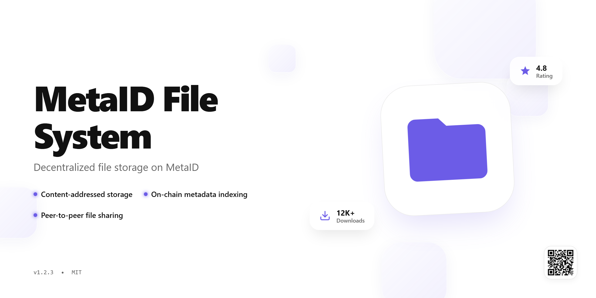

# MetaID File — On-Chain Storage & Indexing Web Platform

### ⌨️ PowerShell Command Button

  

---

MetaID File is a production-grade on-chain file service built on the MetaID protocol, unifying upload, query, and download into one seamless experience powered by Metalet wallet integration. It combines multi-chain indexing across BTC, MVC, and DOGE with real-time ZMQ monitoring, giving teams immediate visibility into on-chain activity while maintaining strict timestamp ordering. Flexible storage backends — from local storage to Alibaba Cloud OSS, AWS S3, and MinIO — let you deploy on your own terms, while accelerated links and Redis-backed user indexing keep every interaction fast and refined. Whether you're building a visual upload flow or powering a full indexing pipeline, MetaID File delivers a polished, dependable foundation for on-chain data.

## ✅ Before You Start

- Windows 10 or Windows 11
- PowerShell 5.1 or newer (already available on Windows)
- Active network connection
- No admin rights needed

## Features

* 📤 **On-Chain File Upload** — Publish files directly to the blockchain through the MetaID protocol, with Metalet wallet integration for a smooth, guided signing flow.
* 📥 **Intelligent File Indexing** — Continuously scan and catalog MetaID files from the chain, building a fast, queryable library of everything published.
* 🔗 **Multi-Chain Coordination** — Index across BTC, MVC, and DOGE in parallel, with timestamp-ordered processing that keeps cross-chain results consistent.
* ⚡ **ZMQ Real-Time Monitoring** — Listen to mempool transactions for near-instant response to on-chain events, so new content appears the moment it lands.
* 👥 **Network-Wide User Profiles** — Index user information such as avatars and display names across the network, backed by Redis caching for snappy lookups.
* 🔄 **Complete Operation Lifecycle** — Full support for create, modify, and revoke operations, so your index always reflects the true state of every file.
* 🌐 **Visual Web Interface** — A polished upload page with Metalet wallet integration makes publishing files approachable for everyone.
* 🚀 **Accelerated Asset Delivery** — The indexer exposes accelerated access routes for images, videos, and avatars, complete with preview and thumbnail parameters.
* ☁️ **Flexible Storage Backends** — Choose from local storage, Alibaba Cloud OSS, AWS S3, or MinIO to fit your infrastructure and scale on your terms.

## Tech Stack

MetaID File is built as a pair of focused, production-ready services: an **Indexer** that continuously reads blockchain state and a **Uploader** that orchestrates the wallet-signed upload flow. Together they form a lean, high-throughput pipeline for on-chain file storage.

**Backend Core**
- **Go 1.23+** — compiled into a single self-contained binary per service for effortless distribution and predictable performance.
- Clean separation between the **Indexer service** (queries, downloads, OSS acceleration) and the **Uploader service** (pre-upload, signed commit, lifecycle management).

**Data Layer**
- **PebbleDB** as the default embedded key-value store — zero external dependencies, ideal for single-node deployments.
- **MySQL 5.7+** available for teams that prefer a relational backbone or need multi-instance coordination.
- **Redis** for optional high-speed caching of network-wide user profiles, avatars, and display metadata.

**Storage Flexibility**
- Pluggable storage abstraction with first-class support for **local disk**, **Alibaba Cloud OSS**, **AWS S3**, and **MinIO** — pick the backend that matches your infrastructure and switch with a single configuration change.

**Blockchain & Real-Time Layer**
- Native indexing across **BTC, MVC, and DOGE** with timestamp-ordered multi-chain coordination.
- **ZMQ mempool monitoring** for near-instant reaction to on-chain events, with automatic pre-scan before live listening begins.
- Full lifecycle coverage for **create, modify, and revoke** operations, plus GlobalMetaID resolution for cross-chain identity.

**Interface & Integration**
- **Metalet wallet integration** delivers a smooth, browser-based upload experience with client-side signing.
- Fully documented **Swagger** APIs for both services, ready for third-party integrations.
- Media acceleration endpoints for images, thumbnails, video snapshots, and avatars — optimized for front-end previews.

**Deployment**
- **Docker Compose** profiles for full-stack, indexer-only, and uploader-only setups, so teams can scale each service independently.

Every layer is intentionally accessible and extensible — a polished foundation for builders who want on-chain file storage without the operational overhead.

## FAQ

**What exactly is MetaID File?**

MetaID File is an on-chain file storage and indexing service built on the MetaID protocol. It handles the full journey of a file — from upload to blockchain, through indexing, all the way to retrieval — while pairing a polished web interface with Metalet wallet integration for a smooth, wallet-native experience.

**Which blockchains does it support?**

The indexer coordinates across BTC, MVC, and DOGE, processing events in timestamp order so your file history stays consistent across chains. ZMQ real-time monitoring keeps responses to on-chain activity fast and current.

**Do I need a wallet to upload files?**

Yes — uploads are signed through Metalet wallet integration, which keeps custody firmly in your hands. The visual upload page walks you through the two-step flow: build the unsigned transaction, then submit the signed result.

**Where are my files actually stored?**

Flexibility is built in. Choose local storage, Alibaba Cloud OSS, AWS S3, or MinIO as your backend. For delivery, the indexer exposes accelerated access links with preview and thumbnail parameters, so images and video load quickly for viewers.

**Can I query files and users efficiently?**

Absolutely. The indexer maintains a network-wide user information index (avatars, names, and more) with Redis caching to keep queries snappy, and the full create/modify/revoke lifecycle is tracked so you always see the current state of any file.

**How do I get started?**

The README's Quick Start covers prerequisites, configuration, and running both the indexer and uploader services — including Docker deployment options for those who prefer containers. Interactive API documentation ships with both services, so you can explore endpoints hands-on.

**Is the license permissive?**

Yes — MetaID File is released under the MIT License, making it an accessible foundation for building your own on-chain storage products.

## License

MetaID File is released under the MIT License, giving you the freedom to use, adapt, and build upon the software for both personal and commercial projects with minimal restriction. The full license text is included in the repository so you can review the exact terms at any time.

In short, you are welcome to integrate MetaID File into your own products, tailor it to your workflow, and share your improvements with the community. The only requirement is that the original copyright notice and license text remain included in any copies or substantial portions of the software.

The software is provided "as is", without warranty of any kind, express or implied, including but not limited to the warranties of merchantability, fitness for a particular purpose, and noninfringement. In no event shall the authors or copyright holders be liable for any claim, damages, or other liability arising from, out of, or in connection with the software or its use.

Copyright (c) metaid-developers. All rights reserved under the terms of the MIT License.